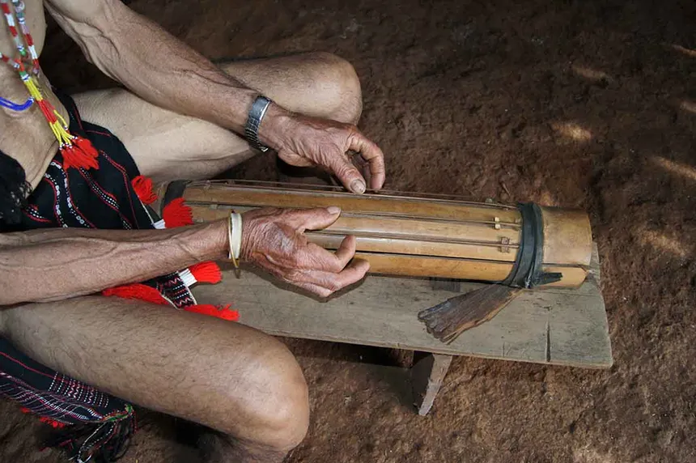
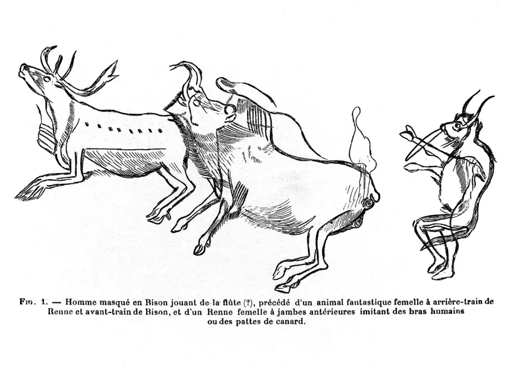
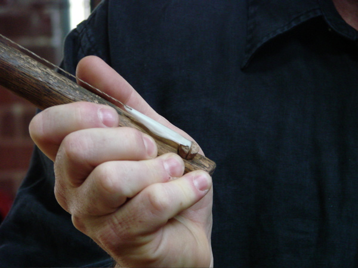
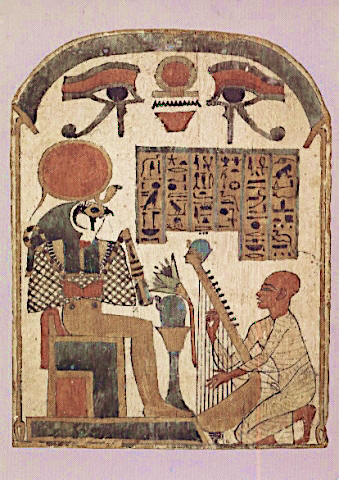
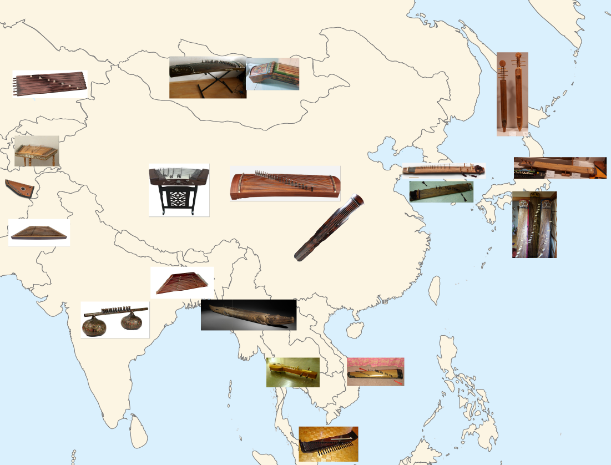
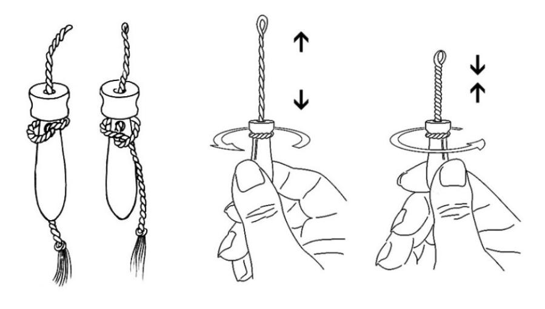
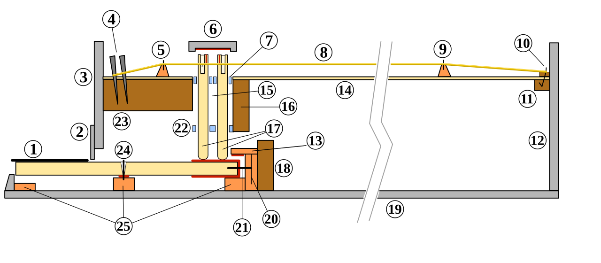
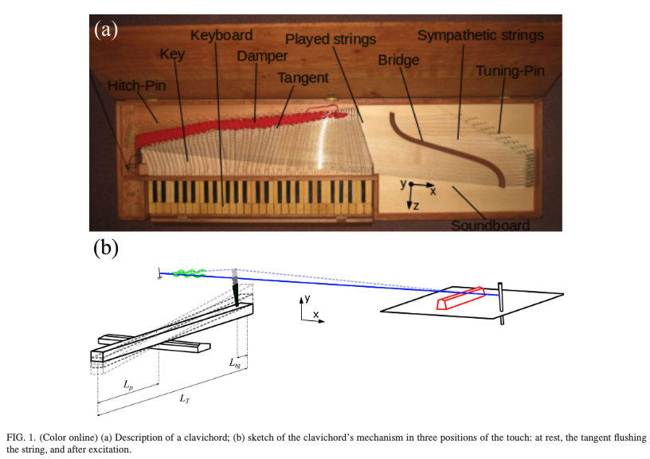
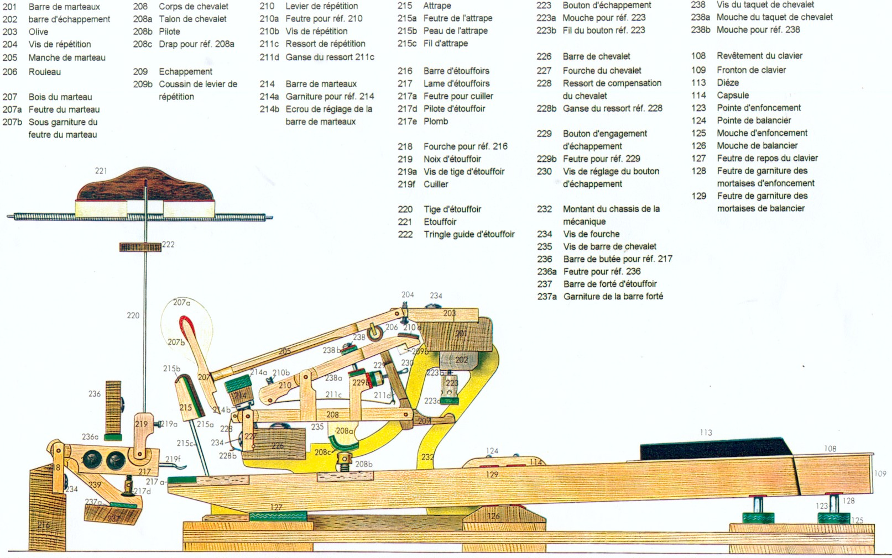

# Cordophones

Nous allons maintenant rentrer dans le sujet que je connais le mieux et qui fait partie intégrante de mes recherches. Je vais donc sans doute être plus loquace en vous parlant de cette catégorie, mais vais essayer de rester clair et cohérent dans la lignée de ce que nous avons esquissé avec les catégories précédentes. Je rentrerai notamment dans le détail des cithares sur table bombées qui sont directement mon objet de recherche. Il ne vous est absolument pas demandé de renseigner cette catégorie avec autant de détail. Si vous essayez néanmoins de rentrer dans le détail de cette catégorie spécifique, j'attends néanmoins que vous ne fassiez pas d'erreurs.  

:::{.callout-note}
# Définition

Un cordophone est un instrument dont l'élément vibrant (la corde) est susceptible de tension. 

:::


En énonçant qu'un cordophone est un instrument dont l'élément vibrant est une corde susceptible de tension, vous commencez à réaliser l'ampleur de la tâche qui nous attend : regrouper de manière cohérente l'ensemble des instruments comportant des cordes. 

:::{.callout-warning}
# Point de vocabulaire important

Je vais sans doute utiliser les termes "simples" et "complexes". Ces deux termes ne renvoient évidement pas à un quelconque jugement de valeur sur l'instrument. Ici, le couple de notion complexité-simplicité renvoie à un nombre d'éléments en interaction. un instrument complexe tout comme un système complexe comporte un grand nombre d'éléments agencés les uns avec les autres. 

:::


## Arc musical

Pour commencer cette exploration des cordophones, nous allons nous intéresser à l'agencement le plus simple : une corde et un bâton. Selon André @schaeffnerOrigineInstrumentsMusique1980, serait le premier instrument à corde joué par les humains. Présenter les choses de cette manière est néanmoins très audacieux car nous ne possédons pas les preuves nécessaires pour l'affirmer définitivement et nous pouvons imaginer d'autres cordophones possibles. Ce que nous pouvons néanmoins affirmer, c'est qu'il s'agit d'un instrument joué depuis longtemps. Très longtemps.

### Les premières traces d'arcs musicaux

Retrouver des traces matérielles d'arcs musicaux est mission impossible. Un arc musical est constitué de deux éléments : un support flexible arqué et une corde susceptible de tension. À la préhistoire et jusqu'à une période récentes, les matériaux sont périssables et ne se conservent qu'en présence de conditions rares et précises — nous y reviendrons. Malgré cette absence de preuves matérielle, nous pouvons nous pencher sur des preuves iconographiques. 

Il me semble absolument fondamental de préciser que les arcs **musicaux** sont distinct des arcs de **chasse**, ils sont souvent bien plus grands et sont aussi souvent idiocordes [@sachsHistoryMusicalInstruments1968, 56]. Un instrument *idiocorde* est un cordophone dont la ou les cordes sont issues du corps même de l'instrument (@fig-cit_tub_idi). 

{#fig-cit_tub_idi}

Sur l'image ci-dessous ([@fig-arc_paleo]), quoi qu'en dise la légende originale, on observe un humain portant une peau de bison jouant de l'arc musical. Ce personnage est précédé de deux animaux fantastiques qui peuvent représenter des esprits. Cette peinture rupestre a été observée dans la grotte des Trois-frères (Ariège, France). Suivant les sources elle est datée du Magdalénien (@fig-frise-magdalenien) ou du Solutréen (~ 18 000 A.E.C.)

{#fig-arc_paleo}

```{r}
#| label: fig-frise-magdalenien
#| fig-cap: "Le Magdalénien dans la séquence du Paléolithique supérieur (dates approximatives, années A.E.C)."
#| fig-width: 8
#| fig-height: 2.2
#| echo: false
#| warning: false
#| message: false

library(ggplot2)

cultures <- data.frame(
  nom   = c("Aurignacien", "Gravettien", "Solutréen", "Magdalénien", "Azilien"),
  debut = c(-41000, -31000, -22000, -17000, -12000),
  fin   = c(-31000, -22000, -17000, -12000,  -9500)
)
cultures$focus <- cultures$nom == "Magdalénien"

etiquette_annees <- function(x) format(abs(x), big.mark = " ", scientific = FALSE, trim = TRUE)

ggplot(cultures) +
  geom_rect(aes(xmin = debut, xmax = fin, ymin = 0, ymax = 1, fill = focus),
            colour = "white", linewidth = 0.8) +
  geom_text(aes(x = (debut + fin) / 2, y = 0.5, label = nom,
                fontface = ifelse(focus, "bold", "plain")),
            size = 3.2) +
  # repère ~15 000 BCE
  annotate("segment", x = -15000, xend = -15000, y = 1.05, yend = 1.35,
           arrow = arrow(length = unit(1.5, "mm"), ends = "first")) +
  annotate("text", x = -15000, y = 1.5, label = "~15 000 A.E.C", size = 3) +
  scale_fill_manual(values = c(`TRUE` = "#d9822b", `FALSE` = "grey85"), guide = "none") +
  scale_x_continuous(labels = etiquette_annees,
                     breaks = seq(-40000, -10000, by = 5000)) +
  coord_cartesian(ylim = c(0, 1.6)) +
  labs(x = NULL, y = NULL) +
  theme_minimal(base_size = 10) +
  theme(axis.text.y = element_blank(),
        panel.grid = element_blank(),
        axis.line.x = element_line(),
        axis.ticks.x = element_line())
```

:::{.callout-note}
# Question

Comment s'assurer qu'il s'agit d'une scène musicale et non d'une scène de chasse ?
:::

:::{.callout-tip}
# Réponse

Il s'agit d'une scène musicale car l'arc n'est pas armé de flèches. De plus, on voit qu'il est porté à la bouche ce qui continue d'être une pratique aujourd'hui.
:::

### Résonateur buccal

L'arc musical ne produit pas beaucoup de son. Il va donc maintenant falloir réfléchir à augmenter le son de l'instrument en gardant uniquement ce morceau de bois et cette corde. On peut placer l'instrument devant sa bouche pour s'en servir comme résonateur. J'obtiens alors un **arc musical à résonateur buccal**. 

Ce dernier peut aussi voir sa corde segmentée. Cela signifie qu'on ajoute une corde qui ne vibre pas mais qui coupe la corde vibrante en deux parties inégales permettant alors de jouer deux notes fondamentales différentes (d'autres notes — harmoniques — pouvant être obtenues par modification de la cavité buccale). 



On peut aussi trouver un type d'arc musical à résonateur buccal comportant un vibrateur de plume. Pour détailler : j'accroche la corde à une extrémité du morceau de bois. Je l'attache ensuite à un petit morceau de plume lui même attaché à l'autre extrémité du morceau de bois ([@fig-det_lesi]). En plaçant la plume entre mes lèvres et en expirant et inspirant fortement, je peux faire vibrer la corde par le souffle. Ce type d'arc musical peut être appelé "arc en bouche". Un exemple est le *lesiba* : 



{#fig-det_lesi}

### Avec résonateur 

Pour augmenter le son de l'instrument, je peux lui adjoindre un résonateur. Ce dernier peut être attaché sur l'arc. C'est par exemple le cas du Berimbau brésilien. 

Importé au Brésil par les populations esclavagisées venues de la côte ouest de l’Afrique. Il est doté d’une **calebasse séchée et vidée** de son contenu (_cabaça_), qui fait office de résonateur. On le joue en frappant la corde en métal (_arame_) tendue par un arc en bois (_verga_) avec une baguette (_baqueta_). La calebasse est maintenue en contact avec l’arc par une ficelle, qui sépare la corde en deux parties et qui détermine l’accordage de l’instrument. D’une main, le musicien porte le berimbau en soutenant la ficelle avec son auriculaire, et tient entre son pouce et son index un **galet ou un disque de métal**(_dobrão_) qu’il utilise pour ajuster l’accordage et le timbre de l’instrument en faisant pression sur la corde. L’autre main tient la baguette ainsi qu’un **hochet de bois tressé** (_caxixi_), qui produit un son à chaque fois que le musicien frappe la corde. Le berimbau peut produire deux notes différentes, ainsi que de nombreux sons percussifs. Il est aussi possible de modifier la distance entre son ventre et la calebasse pour **modifier son timbre** [^noe].



## Harpes

La harpe est définie comme un cordophone dont les cordes sont tendues entre la caisse et un manche arqué ou droit. Les cordes sont --- plus ou moins --- perpendiculaires à la caisse de résonance.

Il s'agit aussi d'un instrument très ancien. On en retrouve en Mésopotamie vers 2055 AEC ([@fig-harpe_meso]), en Algérie vers 800/700 AEC et de nombreuses représentations dans des traités de la période baroque (1600 - 1750).

{#fig-harpe_meso}

On décrit les harpes par rapport à la forme de la caisse. Cette dernière pouvant être :

- Ovoïde ([@fig-harpe_meso] et [@fig-harpe_birmane])
- Hémisphérique ([@fig-harpe_sphérique]) 
- Primatique avec colonne de soutien ([@fig-harpe_llanera]).

:::{#fig-harpe_birmane}



La harpe birmane est un exemple de harpe dont la caisse est ovoïde. 
:::

:::{#fig-harpe_llanera}



La harpe Llanera est un exemple de harpe dont la caisse est prismatique avec une colonne de soutien.
:::

:::{#fig-harpe_sphérique}



Une harpe dont la caisse est sphérique. 

:::

## Cithares

Les cithares possèdent des cordes tendues de part et d'autre parallèlement au corps de l'instrument et ne possèdent pas de manche [@dournonGuidePourCollecte1996]. Archétype = monocorde.

PROBLÈME ! L'arc musical répond parfaitement à cette définition mais possède sa propre catégorie… C'est l'un des principaux reproches à opposer à certaines classifications des instruments de musique. Il faut également distinguer la cithare sur bâton des arcs musicaux. Ces derniers sont flexible alors que les cithares sur bâtons ne le sont pas. 

### Tubulaires

L'exemple type de la cithare tubulaire est la Valiha (prononcé "vali"). Cet instrument est brandi à Madagascar comme un emblème national. Ses cordes peuvent être issue du corps de l'instrument (idiocordes) ou rapportées (hétérocordes). Elles sont réparties tout autour.



### Radeau

Le qualificatif "sur radeau" qui qualifie la caisse de l'instrument vient du fait que l'instrument se compose d'une série de baguettes en bois collées ensemble sur lesquelles sont tendues des cordes (_idiocordes_ ou _hétérocordes_). 

### Sur cuvette

les cithares sur cuvette ne comportent pas de table d'harmonie à proprement dite, la cithare est creuses en dessous des cordes.
  
### L'objet de mes recherches et les cithares sur table bombée

Je vais volontairement faire un focus sur l'objet de mes recherche au sein de cette partie. La caractérisation "sur table bombée" n'a rien d'évident d'un point de vue anthropologique et évolutif. 

:::{.callout-note}
# Évolution et évolutionnisme

Parler d'évolution n'induit en aucun cas une vision évolutionniste. Il est absolument nécessaire de distinguer les deux. L'évolutionnisme est un courant de l'anthropologie qui s'est développé durant la deuxième moitiée du XIX<sup>e</sup> siècle notamment avec @tylorPrimitiveCultureResearches1871. Selon ce courant de pensée, les sociétés humaines évoluent le long d'une échelle de la barbarie vers la civilisation. Ce n'est heureusement plus une pensée qu'on retrouve aujourd'hui dans la recherche. Il a néanmoins tâché le terme "évolution" d'une encre difficile à nettoyer alors qu'il repose sur une définition complètement fausse de ce concept. Si vous ne deviez retenir qu'une seule chose de cet encart c'est la relation suivante : 

$$
\text{Évolution} \neq \text{Progrès}
$$

Par "progrès" il est souvent entendu un changement pour un "mieux" rarement défini. L'évolution signifie uniquement qu'il y a des changements[^evo] partout et tout le temps. Pour reprendre la définition d'Étienne @danchinDNAIntegratingInclusive2011 : l'évolution est un changement dans la fréquence des variantes transmises, sans idée de progrès ni de direction. Pour insister et synthétiser la différence entre "progrès" et "évolution", je citerai la phrase exceptionnelle d'Alex Mesoudi : 

> "Les humains ne sont pas au sommet de l'échelle évolutive car il n'y a pas d'échelle dont ils pourraient être au sommet[^mesou]" [@mesoudiCulturalEvolutionHow2011, 38]

:::

L'Asie orientale est une aire géo-culturelle regroupant la Chine, les Corées, le Japon et le Vietnam dans une certaine mesure. Elle se caractérise par des migrations, du commerce, des guerres et invasions, l'utilisation de sinogrammes et le partage de philosophies et croyances. Cela ne signifie évidemment pas qu'il s'agit d'un ensemble homogène. Les différents pays sont culturellement hétérogènes ne serait-ce que d'un point de vue linguistique. 


On retrouve une grande variété de cithares sur caisse et de cithares sur table bombée en Asie orientale dont une grande parties comportent des chevalets mobiles. Les chevalets mobiles sont des morceaux de bois faisant le lien entre les cordes et la table d'harmonie et pouvant être glissés le long des cordes pour changer l'échelle jouée par l'instrument.



:::{.callout-note}
# Les cithares sur table bombées en Asie orientale, des dénominations compliquées

Les dénominations en langues vernaculaires sont nombreuses et complexes. Elles oscillent entre générique et spécifique. Seule un connaissance du contexte, de l'époque et de la langue peut permettre de proposer une traduction précise de certains mots. Je ne rentrerai pas dans le détail au sein de ce cours et me contenterai de donner quelques exemples. Le mot *koto* (箏 ou 琴) en japonais peut désigner, de manière usuelle (箏), un instrument spécifique (cithare à 13 cordes munie de chevalets mobiles[^def_koto]) qui se nomme précisément *sô* (箏). Dans le contexte d'une traduction littéraire, il sera donc traduit "koto" ou "cithare à 13 cordes". Il (琴) peut aussi désigner une catégorie générique, celle des cithares. Ce sera donc la traduction choisie dans ce second cas. En témoigne l'appellation spécifique complète de l'instrument : *sô no koto* (箏の琴), traduit littéralement : *sô* [appartenance] *cithares*, ou : "l'instrument '*sô*' dans la catégorie des cithares". Heureusement, le japonais est une langue comportant des particules dont la fonction est purement grammaticale (*no* (の), *ha*/*wa* (は), etc.) qui aident à la traduction. Ces particules n'existent pas vraiment en chinois, ce qui entraîne encore aujourd'hui des débats autour de la traduction de certains termes (le sens du couple "*qin-se*" (琴瑟) notamment). 

Pour vous donner un aperçu du nombre important de dénomination dans le groupe des cithares en Asie-orientale, sur environs 180 instrument dont la majorité ont été décrits sur le terrain, je compte aujourd'hui 25 dénominations différentes. Ce qui est beaucoup plus que la dizaine présentée aujourd'hui dans les ouvrages sur le sujet. 

:::

#### Sans chevalet mobiles

##### Guqin

:::{.callout-note}
# Sur l'utilisation du préfixe *gu-*

Le nom de certains instruments chinois est précédé du préfixe *gu-* (古) qui signifie "ancien" ou "antique". Cela renvoie à la supposée ancienneté[^anc] de l'instrument. Il est possible d'omettre ce préfixe. Je décide néanmoins de le garder en raison de son usage dans le langage usuel en langue vernaculaire.  
:::

Le *guqin* est une cithare sur table bombée dont les cordes ne sont pas parallèles entre elles. Sur le dessus de l'instrument, on peut observer la présence de 13 blasons (*hui*, 徽) qui indiquent l'emplacement des harmoniques. 



Le système de mise en tension des cordes est un peu particulier. Georges Goormaghtigh le décrit particulièrement bien : 

>"Chacune des sept cordes est accrochée à son tendeur par un système ingénieux: un nœud situé à l'une des extrémités de la corde est retenu dans une tresse de fils de soie, cette tresse est elle-même attachée à une cheville libre qui n'est pas fichée dans une cavité du bois mais tient à l'instrument par la seule vertu de la tension de la corde. Pour contrôler cette tension, on tourne la cheville qui, en serrant ou desserrant la torsade modifie sa longueur. Le nœud de la corde, captif des soies du tendeur, transmet ces changements de tension. L'autre extrémité de la corde est enroulée autour d'un des deux pieds situés sous l'instrument." [@goormaghtighChantPecheurIvre2010, p.17]



Instrument des lettrés, le *guqin* est entouré de nombreux symboles et pouvoirs d'influences sur le monde. Ces symboles sont eux aussi particulièrement bien expliqués par le même auteur : 

>"Le qin incarne tout un mode de pensée. Il est un microcosme à l'image du macrocosme qu'est l'univers : partie supérieure bombée comme le Ciel, partie inférieure plate comme la Terre. Sa longueur de trois pieds, six pouces, cinq dixièmes symbolise les trois cent soixante cinq jours de l'année solaire; sa largeur de six pouces correspond aux quatre points cardinaux plus le zénith et le nadir. Les treize marques d'harmoniques qui se trouvent sur la table de l'instrument représentent chacune l'un des douze mois de l'année, plus un, la marque du centre, qui correspond au mois intercalaire, celui l'on rajoutait une fois tous les quatre ou cinq ans combler l'écart entre l'année lunaire et l'année solaire." [@goormaghtighChantPecheurIvre2010, p.22]

Instrument des rituels confucéens reflétant l'ordre social, certains penseurs et auteurs lui prêtent aussi des capacités "magiques". En témoigne un passage du *Liezi*[^1] dans le chapitre 5 :

> "Jadis Huba faisait danser les oiseaux et sauter les poissons de l'eau en jouant du _qin_. Un musicien du royaume Zheng, Shi Wen, en entendit parler, il quitta sa maison et alla trouver Shi Xiang afin de lui apprendre son art. Il resta trois ans auprès de lui, essayant d'accorder les cordes et ne les ayant pas touchées de ses doigts. Shi Xiang dit : "tu peux rentrer chez toi." Alors Shi Wen écarta le _qin_ et s'écria : "ce n'est pas que je ne puisse accorder l'instrument, ce n'est pas que je ne puisse jouer les œuvres. Ce que je cherche à comprendre ce ne sont pas les cordes, ce à quoi j'aspire ce ne sont pas les modes. La vérité n'atteint pas mon cœur et n'apparaît pas dans les sons de l'instrument, voici pourquoi je ne peux remuer mes mains et mettre en mouvement les cordes. Donnez moi encore un peu de temps, vous verrez quand je serais revenu."

> Quelques temps après il revint chez Shi Xiang. Celui ci demanda : "Comment joues-tu du _qin_ maintenant ?" Shi Wen répondit : "J'ai atteint ce à quoi j'aspirais. Je demande la permission de le montrer." C'était le printemps mais il produisit avec la corde _shang_ la note _nanlü_ et un vent frais souffla , et les fruits sur les arbres et dans l'herbe mûrirent, et ce fût l'automne. Mais, avec la corde _jue_, il produisit le son _jiazhong_ et un vent tiède souffla doucement et les herbes et les arbres fleurirent. L'été vint, mais quand il produisit, avec la corde _yu_ la note _huangzhong_, la neige tomba et le givre recouvrit tout et les rivières et les étangs furent gelés en un instant. L'hiver vint, mais avec la corde _zhi_ il produisit la note _ruibin_ et le soleil se mit à briller et la glace fondit. A la fin il fit résonner la corde _gong_ et y ajouta les sons des autres cordes, alors un vent souffla, les hauts nuages s'étirèrent dans le ciel, la rosée odorante tomba et des sources se mirent à couler. Shi Xiang mit sa mains sur son cœur, sauta sur ses pieds et s'écria : "Ton jeu est merveilleux en vérité ! Personne ne pourrait égaler l'exécution du Qingjue par Shi Kuang, ni le jeu de la flûte de Zou Yan ; eux aussi, pourtant, l'un portant son _qin_ sous le bras et l'autre avec sa flûte, ils voudraient te suivre[^liezi]." Traduction de [@sissaouriEtudeMusiqueAncienne1985, pp.15-16]

##### Tonkori

Le *tonkori* est une cithare sur table dont les cordes sont parallèles entre elles. Elles est brandie par les populations aïnoues comme un symbole. Elle peut être jouée en solo, en ensemble ou accompagner le chant. 

L'instrument a presque disparu durant la deuxième moitiée du XIX<sup>e</sup> siècle mais il connait aujourd'hui un regain d'intéret notamment en raison de le réappropriation d'une identité culturelle aïnoue. 

L'un des principaux acteur de ce *revival* se nomme Oki. 





##### Nigenkin etc.

Au Japon, certaines cithares se nomment $x + \text{genkin (弦琴)}$ où $x$ est le nombre de cordes en langue vernaculaire. On les retrouve dans l'ensemble des îles du japon. Quelques cithares retrouvées dans des tombes datant du premier siècle AEC. Certains auteurs y voient un lien avec le *tonkori* évoqué plus tôt [@hughesMusicArchaeologyJapan1988, p.63]. Aujourd'hui ces instruments ne sont quasiment plus utilisés et sont majoritairement des instruments de musées.



#### Munies de chevalets mobiles

#### Guzheng

Cithare sur table bombée comportant des chevalets mobiles. Relativement populaire aujourd'hui notamment en raison de la présence de musicien sur le réseau social chinois _xiaohongshu_  qui peuvent cumuler autour de 250 000 follower[^2]. 

On trouve beaucoup de reprises de chansons populaire jouées à cet instruments. Il est aussi très présents dans certains titres comme évocation d'un "son" chinois. 



:::{#fig-reprise}



Reprise au *guzheng* d'une chanson[^rep_jay] de Jay Chou (Zhou Jielun, 周杰伦), célèbre chanteur de C-pop.

:::

#### Se
Cithare sur table bombée comportant des chevalets mobiles qu'on retrouve cité dans de nombreux textes anciens. Aujourd'hui c'est un instrument de musée. Les 25 cordes de l'instrument sont scindés en quatre groupes et attachés à des points fixes.  



#### Gayageum

Égelemment cithare sur table bombée munie de chevalet mobiles. Elle est présente dans de nombreux drama historiques coréens. On trouve aussi de nombreuses reprises sur youtube. En corée du sud, l'instrument est beaucoup utilisé comme un moyen de _softpower_ [@nyeParadoxAmericanPower2002; @gauchon100MotsGeopolitique2019]. En revanche, à l'intérieur du pays, peu de jeunes en jouent et l'instrument décroit progressivement comme m'en ont témoigné des professionnel du secteurs culturel sud-coréen.



#### Koto

Idem que pour le *guzheng* et le *gayageum*. L'instrument est utilisé dans les orchestres de cours encore aujourd'hui. Il se joue aussi dans un ensemble instrumental nommé _sankyoku_ (三曲) qui comporte un *koto*, un *shamisen* et un *shakuhachi*. On trouve l'instrument dans un anime qui lui est dédié (_Kono Oto Tomare! Sounds of Life_, この音とまれ!).



:::{#fig-kono_oto_tomare}



Extrait de l'anime *Kono oto tomare*.

:::
#### Geomungo

Cithare sur table bombée jouée avec un plectre mélangeant des chevalets fixes et mobiles. On retrouve l'instrument dans des drama-historiques coréens et dans certains morceaux de k-pop (pop coréenne). 

:::{.callout-note}
# Petite note sur l'appellation _-sanjo_ (산조) en coréen. 

L'appelation *-sanjo* (산조) désigne à la fois un genre musical qu'une déclinaison d'instrument. Le *sanjo* est un genre pour instrument soliste. le *geomungo-sanjo* (mais on trouve aussi le *gayageum-sanjo*) est un instrument plus fin et adapté à la pratique du jeu en soliste. 

:::



:::{#fig-black_pink}



Dans *Pink venom* (2022) du groupe de k-pop Blackpink on observe le *geomungo* au début du morceau.

:::

#### Danbau

Le _danbau_ est un monocorde vietnamien à tension variable. La personne qui en joue varie la tension de la corde avec une baguette à la tête de l'instrument. 



### Sur caisse

#### Qanun 

Le qanun est une cithare sur caisse de forme trapézoïdale qui se trouve dans l'ensemble du moyen-orient. 



#### Dulcimer/Cymbalum/Tympanon

Cithare sur caisse de forme trapézoïdale à corde frappées. On retrouve cet instrument de l'europe à la Chine. Cela en fait un instrument important notament dans l'étude des musiques de la route de la soie. 







#### Le clavecin

Le clavecin est une cithare sur caisse trapézoïdale munie d'un clavier. Il est mentionné à la fin du XIV<sup>e</sup> siècle dans des sources textuelles et représenté au début du XV<sup>e</sup> siècle dans des sources iconographiques [@kottickHistoryHarpsichord2003]. L'instrument se décline suivant son pays de production. On compte ainsi les clavecins : français, italiens, franco-flamand et allemands. Ils se distinguent par leurs morphologies, leurs fonctionnalités et leurs timbres. Ces variations sont notamment dûes aux contextes de jeu. 

Cet instrument à été l'objet de diverses expérimentations : clavecin à quart de tons (*Archicembalo* ou *Clavemusicum Omnitonum*), clavecin à pédalier, clavecin à triple manuel[^clav_man], etc. 

:::{#fig-clavecin}


"Coupe longitudinale (schéma de principe) d'un clavecin de type flamand à un clavier et deux jeux de huit pieds. 1) touche, 2) couteau, 3) barre de nom, 4) chevilles d'accord, 5) sillet, 6) chapiteau, 7) registres mobiles, 8) corde, 9) chevalet, 10) pointe d'accroche, 11) contre-éclisse, 12) éclisse courbe/pointe, 13) barre d'enfoncement, 14) table d'harmonie, 15) fosse, 16) contre-sommier, 17) sautereaux, 18) masse, 19) fond, 20) peigne, 21) pointe de guidage, 22) registres fixes, 23) sommier, 24) pointe de balancement, 25) cadre du clavier", source : [wikipedia](https://fr.wikipedia.org/wiki/Clavecin#/media/Fichier:Clavecin_mecanisme.svg)
:::

:::{#fig-clav_chrom}


*méditation sur ma mort future*, Froberger, Interprété par Johannes Keller sur un clavecin à 24 sons par octaves accordés en mésotonique. 
:::


:::{#fig-clav_ital}


*cento partite sopra passacagli*, Girolamo Frescobaldi, interprété par Bob van Asperen sur un clavecin italien. 
:::

:::{#fig-clav_tr_man}


*concerto italien*, J.S. Bach, interprété par Diego Ares sur un clavecin à triple manuel
:::

#### Le clavicorde

Le clavicorde est une cithare sur caisse munie d'un clavier. Les cordes sont frappées par des *tangentes* en métal directement reliées aux touches. Il s'agit de l'un des rares cordophone à clavier capable de faire du vibrato. Cette technique se nomme *bebung*.  

:::{#fig-clavicorde}



Description du mécanisme d'un clavicorde. Source : @jiolatPhysicalModelClavichord2021. 
:::





#### Le piano

Le piano est une cithare sur caisse munie d'un clavier. Les cordes sont frappées par des marteaux reliés aux touches par un système complexe (au sens de : composé de nombreux éléments) de poids et contrepoids pour envoyer les marteaux contre la corde. Aujourd'hui les marteaux sont recouvert de feutres. Sur certains *pianoforte* plus anciens, ils peuvent être recouverts de cuir.

:::{#fig-piano_queue}



Schéma en coupe du mécanisme d'un piano à queue moderne. Source : [Piano-e-forte](https://www.piano-e-forte.com/)

:::


:::{#fig-piano_anc}


sonate op.81, Hummel, interprété par [Eloy Orzaiz](https://eloyorzaiz.com/?lang=fr) sur une reproduction d'un piano historique première moitié XIX<sup>e</sup> siècle. 

:::



## Luths

Les luths sont des cordophones dont les cordes sont tendues entre une caisse et un manche **disposés dans un même plan**. 

### À cordes pincées

#### Monoxyle

Le terme *monoxyle* signifie que la caisse de résonance et le manche sont fabriquées dans un seul morceau de bois. Attention, il ne s'agit bien que de la caisse et du manche, la table peut être rapportée (c'est le cas dans la majorité des cas). 

##### Qanbus



##### Pipa/Biwa

Le luth *pipa* (琵琶) est un luth monoxyle dont la table est piriforme.




Le *biwa* (琵琶) est un instrument à cordes en soie utilisé dans la musique traditionnelle japonaise. Le corps de l’instrument est taillé dans un seul bloc de bois dur. Il possède cinq frettes inamovibles.  Il serait apparenté au luth *barbat* Persan et se joue avec un plectre ressemblant à un petit éventail. Il est souvent joué dans des représentations publiques et accompagne la voix qui peut raconter des légendes. Il est de moins en moins joué, sauf pour quelques personnes d’un âge avancé qui en jouent encore[^desc_biwa].



##### Rabab

Luth monoxyle dont la table est échancrée. 



#### Composite

Pour les luths composites, le manche est fait dans un autre morceau de bois que la caisse. 

##### Manche fixé - monocoque

On parle de caisse monocoque lorsque la caisse est fabriquée dans un seul morceau de bois. 

Luth monocoque dont la table est circulaire Sitar (Inde). Il possède des **cordes sympathiques**.

:::{.callout-important}
# Cordes sympathiques

Les cordes sympathiques sont des cordes généralement placées sous les cordes de jeu. Elles n'ont pas vocation à être jouée mais résonnent par *sympathie* avec les harmoniques produites par les cordes de jeu. 

:::



Luth monocoque à table ovoïde à manche long (Asie centrale)



Luth monocoque à table échancrée (Amérique du sud) 


##### Manche fixé - caisse en plusieurs éléments (dont éclisses)

Caisse triangulaire --- Balalaika (Europe de l'est)


Caisse échancrée et fond plat --- guitare classique moderne 



##### Manche traversant 

Luth *tidinit* (Mauritanie) dont le manche rapporté traverse la table d'harmonie.



### À corde frottées - vièles

Les vièles sont des luths dont les cordes sont frottées (par un archet, un morceau de bois, une roue ou un autre dispositif). Cette catégorie reprend les mêmes embranchements que celle des luths à cordes pincées. Ces deux catégories sont tellement similaires qu'elles ont fusionné dans la classification de @dournonInstrumentsMusiquesMonde2007

#### À archet

##### Monoxyle

Avec table ovale en bois



ou en peau 



Certains instrument peuvent comporter des cordes sympathiques : 



##### Composite

Dont la table est échancrée :



Et qui peut comporter une pique : 



On peut aussi observer d'autres formes de caisse.

Cylindrique avec table en peau ou en bois :



Prismatique : 



et de nombreuses autres formes.

#### Par un archet et un clavier

Certaines vièles se sont dotée d'un clavier tout en continuant d'utiliser un archet 



#### Par une roue

Tandis que certaines, en gardant le clavier, ont été dotée d'une roue en remplacement de l'archet.



# Quelques cas particuliers

Certains cas particuliers sont à repérer.

## Harpe-luth

Une harpe-luth est un cordophone dont les cordes sont tendues entre une manche et une caisse dans un même plan (luth). Les cordes sont tendues perpendiculairement (harpe) et soulevées par un chevalet.



## Harpe-cithare

Une harpe-luth est un cordophone dont les cordes sont tendues sur un bâton (cithare). Les cordes sont tendues perpendiculairement (harpe) et soulevées par un chevalet.



La harpe luth peut être idiocorde. 

## Lyre

La lyre est un cordophone dont les cordes sont tendues entre un **joug** soutenu par deux **montants** et une caisse de résonance. Il faut bien faire attention de la distinguer de la harpe.



# Références {.unnumbered}

[^1]: Le Liezi est un recueil de court textes philosophiques.

[^2]: Ce chiffre est à relativiser. C'est un succès pour une échelle occidentale mais en comptant la taille de la population chinoise, ce n'est pas énorme. Certains utilisateurs cumulent près de 17,5M de followers (cas de Fan Bingbing, 范冰冰). 

[^noe]: Paragraphe écrit avec l'aide de Noé Blin Bião, doctorant en ethnomusicologie (Sorbonne Université, IReMus), spécialiste des musiques brésiliennes. 

[^liezi]: Texte original en chinois mandarin : "匏巴弹琴，能使鸟儿飞舞、鱼儿跳跃。郑国的师文听说后，便离开了家o，跟随师襄游学，按指调弦，但三年也弹不好一支乐曲。师襄说：“你可以回家了。”师文放下他的琴，叹了口气说：“我并不是不能调弦，也并不是弹不好乐曲，而是我心中所存在的不是琴弦，脑子所想的不是乐声，心内不能专注，心外便不能与乐器相应，所以不敢放开手去拨动琴弦。姑且少给我一些时日, 看看我以后怎样。" / "没多久，又去见师襄。师襄问：“你的琴怎样了？”师文说：“行了。请让我试试吧。”于是在春天里拨动了商弦，奏出了南吕乐律，凉爽的风忽然吹来，草木随之成熟并结出了果实。到了秋天，又拨动角弦，奏出了夹钟乐律，温暖的风慢慢回旋，草木随之发芽并开出了花朵。到了夏天，又拨动羽弦，奏出了黄钟乐律，霜雪交相降落，江河池塘突然冻结成冰。到了冬天，又拨动徵弦，奏出了蕤宾乐律，阳光炽热强烈，坚固的冰块立刻融化。弹奏将要结束，又拨动宫弦，奏出了四季调和乐律，于是和暖的南风回翔，吉祥的彩云飘荡，甘甜的雨露普降，清美的泉水流淌。师襄便抚摸着心房蹦了起来，说：“你弹奏得太微妙了！即使是师旷弹奏的清角，邹衍吹奏的声律，也不能超过你，他们将挟着琴弦、拿着萧管跟在你后面向你请教了。”

[^evo]: Suivant les auteurs et autrices, on trouve les mots "changements", "variations" ou "mutation". Ces différents concepts portent de fines différences de définitions sur lesquelles je ne m'épencherai pas ici (si vous poursuivez en Master, vous aurez le cours "évolution culturelle et musique" qui vous introduira ces finesses terminologiques).  

[^mesou]: Ma traduction, texte original en anglais : "Humans are not at the top of the evolutionary ladder, because there is no ladder of which to be at the top".

[^anc]: Je précise "supposée" car, bien qu'on ai des traces de cithares très anciennes en Chine, la robustesse du lien de parenté entre les instruments très anciens et les instruments moderne n'a pas encore été évaluée. Pour le *guqin*, l'instrument le plus ancien ayant une morphologie se rapprochant de la forme "moderne" date de ca. 500 EC [@lawergrenChineseStringInstruments2000].

[^rep_jay]: La chanson originale est la suivante : 

[^def_koto]: Cette définition est très imparfaite mais, tant que des tests n'ont pas été menés, je n'ai pas mieux. 

[^clav_man]: Le terme "manuel" désigne les claviers : double manuel $=$ deux claviers, etc. 

[^desc_biwa]: Paragraphe écrit par Lucie Kirch dont le travail de recherche porte sur les femmes joueuses de biwa. 